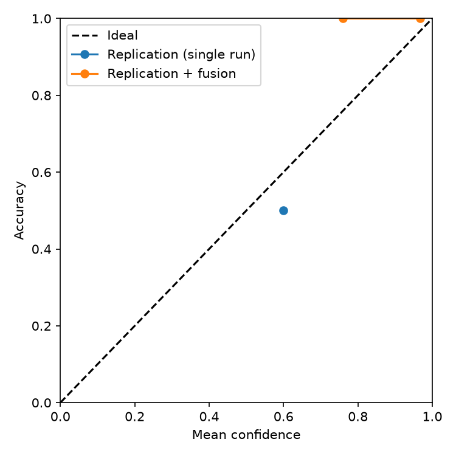
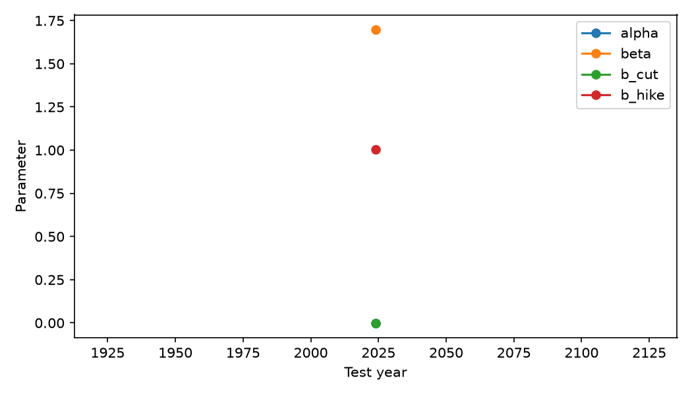

# Phase 2: single-run fusion (not the six-variant final table)

N = 2 common meetings; hold rate = 0.500.
Percentile 95% CIs from 1000 paired meeting bootstrap resamples, seed 42.
Brier is the sum across three classes; ECE is top-label confidence, 10 equal-width bins.
Adaptive ECE uses up to 10 equal-count bins. Macro-F1 includes all three classes, with zero for missing classes.
MCC is N/A when its denominator is zero; bootstrap intervals use only defined replicates and may be unreliable.
Always-hold and hard replication use smoothed one-hot probabilities (0.2, 0.6, 0.2); other variants use their predicted probabilities.

| Variant | Accuracy | Macro-F1 | MCC | Brier | Log loss | ECE | Adaptive ECE |
|---|---:|---:|---:|---:|---:|---:|---:|
| Always-hold | 0.500 [0.000, 1.000] | 0.222 [0.000, 0.333] | N/A | 0.640 [0.240, 1.040] | 1.060 [0.511, 1.609] | 0.100 [0.100, 0.600] | 0.500 [0.400, 0.600] |
| Market-only logit | 1.000 [1.000, 1.000] | 0.667 [0.333, 0.667] | 1.000 [1.000, 1.000] | 0.125 [0.023, 0.226] | 0.271 [0.131, 0.410] | 0.230 [0.123, 0.337] | 0.230 [0.123, 0.337] |
| Replication (single run) | 0.500 [0.000, 1.000] | 0.222 [0.000, 0.333] | N/A | 0.640 [0.240, 1.040] | 1.060 [0.511, 1.609] | 0.100 [0.100, 0.600] | 0.500 [0.400, 0.600] |
| Replication + fusion | 1.000 [1.000, 1.000] | 0.667 [0.333, 0.667] | 1.000 [1.000, 1.000] | 0.058 [0.002, 0.115] | 0.153 [0.032, 0.274] | 0.136 [0.032, 0.239] | 0.136 [0.032, 0.239] |

## Confusion matrices and per-class precision/recall

Matrices have true labels as rows and predicted labels as columns, ordered cut / hold / hike. Non-hold matrices omit true-hold rows only.

**Always-hold**  
All: `[[0, 1, 0], [0, 1, 0], [0, 0, 0]]`  
Non-hold: `[[0, 1, 0], [0, 0, 0]]`  
Precision (cut, hold, hike): `['N/A', 0.5, 'N/A']`; recall: `[0.0, 1.0, 'N/A']`.

**Market-only logit**  
All: `[[1, 0, 0], [0, 1, 0], [0, 0, 0]]`  
Non-hold: `[[1, 0, 0], [0, 0, 0]]`  
Precision (cut, hold, hike): `[1.0, 1.0, 'N/A']`; recall: `[1.0, 1.0, 'N/A']`.

**Replication (single run)**  
All: `[[1, 0, 0], [1, 0, 0], [0, 0, 0]]`  
Non-hold: `[[1, 0, 0], [0, 0, 0]]`  
Precision (cut, hold, hike): `[0.5, 'N/A', 'N/A']`; recall: `[1.0, 0.0, 'N/A']`.

**Replication + fusion**  
All: `[[1, 0, 0], [0, 1, 0], [0, 0, 0]]`  
Non-hold: `[[1, 0, 0], [0, 0, 0]]`  
Precision (cut, hold, hike): `[1.0, 1.0, 'N/A']`; recall: `[1.0, 1.0, 'N/A']`.

## Near-zero-rate calendar regimes

Calendar proxy: 2009–2015 and 2020–2021 (not an observation-level rate threshold).
- ZLB proxy: n=0
- Other years: n=2
  - Always-hold: accuracy 0.500, log loss 1.060
  - Market-only logit: accuracy 1.000, log loss 0.271
  - Replication (single run): accuracy 0.500, log loss 1.060
  - Replication + fusion: accuracy 1.000, log loss 0.153
## Model knowledge cutoff

Unknown; no pre/post-cutoff comparison was made.

## Figures

**Warning:** at least one fusion fold has fewer than 40 training meetings; coefficients and metrics are highly unstable.

Coefficients are joint log-linear weights, not normalized shares or causal attribution.
